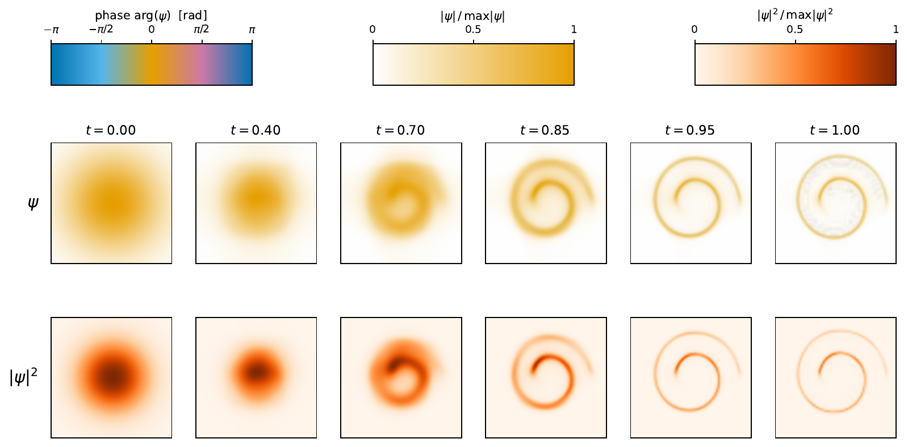

# tnwf — Scalable quantum simulation of continuous-time generative models via tensor networks

Reproduction code for the paper of the same name.

> 📄 Paper: [arXiv:2608.21700](https://arxiv.org/abs/2608.21700)
> 🔖 To cite, see [Paper citation](#paper-citation).



*Wavefunction evolution (Fig 2 of the paper). Top: ψ(t) (hue = arg ψ,
brightness = |ψ|). Bottom: |ψ(t)|². The dynamics under Hᶜ = i[K, Vₜ] transport
the Gaussian source into the target.*

## Overview

We compress the position-diagonal potential (the "V-step") of a wavefunction
flow with tensor networks, evolving a wavefunction MPS under
`exp(iβ V_t)`:

**JAM** (Joint Action Matching — learns a scalar-valued potential function `V_t`)
→ **V-step** methods that apply `exp(iβ V_t)` to the MPS.

### V-step methods

1. **Dense** — exact `O(N^d)` reference
2. **TCI+TDVP1** — TT-cross MPO + 1-site TDVP
3. **TCI+TDVP2** — TT-cross MPO + 2-site TDVP
4. **MPS-V + 2TDVP** — a velocity potential pre-trained as a matrix product state
   (`tnwf.mps_v`) fed straight to the 2-site TDVP V-step, with no runtime tensor
   cross. Train with `python -m tnwf.mps_v.train`; run via
   `run(method="mps_v_tdvp2", ...)`.

## Layout

```
tnwf/
├── src/tnwf/             # package: jam/, mps_v/, mps/, mpo/, dense/, metrics/, data/, pipelines/, amp.py
├── tests/                # pytest suite mirroring src/tnwf/
├── scripts/make_*.py     # one generator per paper float
├── scripts/{dataset}/    # per-dataset runners (train_jam, run_all_methods)
├── examples/rare_event/  # Fig 8's MPS cores (the only bulk data tracked here)
├── pyproject.toml        # package + dependency declarations
└── uv.lock               # fully pinned dependency lock
```

Everything under `scripts/` either generates a manuscript float or produces the
sweep data one consumes. `figures/`, `results/` and the bulk of `data/` are
generated or downloaded, and are not version-controlled.

## Installation

[uv](https://docs.astral.sh/uv/), Python ≥ 3.11:

```bash
uv sync --extra dev
```

## Quickstart

```bash
uv run pytest -m needle              # < 30s
uv run pytest -m medium              # < 5min, full pipeline

uv run python -m tnwf.jam.train --dataset swiss_roll_2d --seed 0
uv run python scripts/swiss_roll_2d/run_all_methods.py --seeds 0,1,2
uv run python scripts/make_fig2_dense_evolution.py   # → figures/fig2_dense.pdf
```

Datasets are generated on the fly: `swiss_roll_2d` and `gmm_2d … gmm_16d`.

## Demo notebook

[`examples/tnwf_demo.ipynb`](examples/tnwf_demo.ipynb) tours the V-step methods
using the closed-form analytic GMM potential. It ships
with outputs rendered and is viewable on GitHub without running anything.

- **Part 1** — `Dense` vs `TCI+1TDVP` on a 3-D Gaussian mixture, t-SNE overlay
  against the target (paper **Fig. 5**, left / *d*=3).
- **Part 2** — the **MPS-V + 2TDVP** pipeline at *d*=8, σ=0.5, loading the
  paper's **Table 2** run (N=32, K=160): sliced Wasserstein
  0.036 ± 0.003 against a sample-size floor of 0.030, self-limiting bond
  χ\* ≈ 16. The shipped `.npz` in
  [`examples/checkpoints/`](examples/checkpoints) holds that run's per-step
  metrics and final-state samples, so nothing reruns for hours. From scratch:
  `scripts/mps_v/generate.py --K 160`.

```bash
make notebook        # or: uv run --with jupyter jupyter notebook examples/tnwf_demo.ipynb
```

Jupyter is pulled in on demand, so it stays out of the locked dependencies.

## Getting the data archive

Most of the floats below read from `data/`, which is **not in this repository**. It is deposited openly under
CC-BY-4.0.

DOI: [10.5281/zenodo.21845216](https://doi.org/10.5281/zenodo.21845216)

```bash
cd tnwf-paper
curl -L -o tnwf-paper-data.tar.gz "https://zenodo.org/records/21845216/files/tnwf-paper-data.tar.gz"

# Verify before unpacking. The build is byte-reproducible, so rebuilding from
# the same inputs reproduces this digest exactly.
echo "4da989236643f206da1a4a98e8e6b75be0f1076cb5955ece66e30f77a62bdd26  tnwf-paper-data.tar.gz" | shasum -a 256 -c

# Unpack AT THE REPO ROOT — every member is rooted at data/, and several
# generators hardcode relative paths like data/gmm_2d_hp/ with no CLI override.
tar xzf tnwf-paper-data.tar.gz

make verify-data          # every file against the archive's own MANIFEST.tsv
```

That creates:

```
data/
├── gmm_2d_hp/  gmm_3d_hp_v2/  gmm_4d_hp/ … gmm_8d_hp/   sweeps  → Fig 5, 6, B1, Table 1
├── scaling_theory/                                      CSVs    → Fig 4
├── timing_scaling/  mps_v_checkpoints/                          → Table 2
└── {swiss_roll_2d,gmm_2d,gmm_3d}/jam/                   JAM ckpts → Fig 2
```

`MANIFEST.tsv` travels inside the archive, so `make verify-data` establishes
internal consistency, not provenance — for provenance use the tarball checksum
above. `data/exact_sw_floor.json` (Table 1's target–target row) is small enough
to live in this repository and is already present.

With the archive unpacked:

```bash
make fig2 fig-scaling-bounds fig-tsne fig-cost-scaling supp table1 table2
make fig-rare-event                                    # needs MPS-V checkpoints
uv run python scripts/make_fig_gmm_ode.py              # needs no archive data
```

## Reproducing the paper figures

Each generator writes to a relative `figures/` path (override with `--out`). The
table covers all ten main-text floats, so what is and is not released is
unambiguous.

| Float | Asset | Generator | Status |
|---|---|---|---|
| Fig 1 | `fig1_overview_tikz.pdf` | — | TikZ, built in the LaTeX source |
| Fig 2 | `fig2_dense.pdf` | `make_fig2_dense_evolution.py` | ✅ needs `jam/seed0.pt` |
| Fig 3 | `fig_gmm_ode.pdf` | `make_fig_gmm_ode.py` | ✅ self-contained |
| Fig 4 | `fig_scaling_bounds.pdf` | `compute_scaling_theory.py`, `make_fig_scaling_bounds.py` | ✅ compute CSVs, then plot |
| Fig 5 | `fig_tsne_grid.pdf` | `make_fig_tsne_grid.py` | ✅ needs sweeps |
| Table 1 | `table1_sw.tex` | `make_table1_sw.py` | ✅ needs sweeps |
| Fig 6 | `fig_cost_scaling.pdf` | `make_fig_cost_scaling.py` | ✅ needs sweeps |
| Fig 7 | `fig_ksweep_trained_std0.5_noHyb_wt.pdf` | *not released* | cloud (Modal) timing driver |
| Table 2 | `table_scaling.tex` | `make_table2_scaling.py` | ✅ needs `timing_scaling` + MPS-V checkpoints |
| Fig 8 | `fig_rare_event_advantage.pdf` | `make_fig_rare_event.py` | ✅ needs MPS-V checkpoints |

**Fig 2–6, Fig 8 and Tables 1–2 reproduce exactly**. Fig 1 is built by LaTeX.
Fig 7 comes from a cloud timing driver whose code is not released.

From the appendices, **Fig B1** is reproducible here with `make supp`; it needs
the same sweeps as Fig 5. The generation code for Fig 7, Table B1, and
Figs B2–B5 is available on request through a repository issue.

Regenerate the Fig 4 CSVs with `make compute-scaling-theory`, then plot with
`make fig-scaling-bounds`. The `data/scaling_theory/` cache is also in the data
archive.

### Appendix B.6: correlated mixtures

- `scripts/correlated_bond_scaling.py` prints Table B2 (bond dimension of a correlated
  Gaussian component in the natural, window-shuffled and random orders) and the bond
  dimension along the flow path. NumPy only; runs in seconds.
- `scripts/correlated_flow.py --d <d>` runs the TCI+1TDVP flow on the correlated mixture
  and prints the correlation recovery. `--angles balanced` and `--substeps 4` rerun
  the step-coefficient comparison; with balanced coefficients at d = 32 this script
  gives R = 0.77 where the paper reports 0.72. Minutes at d = 8, hours at d ≥ 64.

The runs behind Tables B3 and B4 use a phase-operator step and 1TDVP+SE, which are not
part of this release; they are available on request through a repository issue.

### Rerunning the unreleased sweeps

Fig 7, Table B1 and Figs B2–B5 are parameter sweeps run on cloud drivers. Each
cell of a sweep is one call to `tnwf.pipelines.run_evolution.run`; the drivers
loop over cells and collect the returned metrics. To rerun the cells that use a
released V-step:

1. Train the potential once, as a neural network (`python -m tnwf.jam.train`)
   or as an MPS (`python -m tnwf.mps_v.train`).
2. For each cell call `run(method, dataset, N=..., K=...,
   method_kwargs={"D_max": ...})`, or for the trained MPS potential
   `scripts/mps_v/generate.py --K <K> --D_max <D>`. The swept values are given
   in the paper (Fig 7 caption, Table 3, and the appendix sections for each
   float).
3. Score the returned samples with `tnwf.metrics`.

These floats also show the one-site TDVP with subspace expansion (1TDVP+SE),
which is not part of this release. That integrator and the drivers are
available on request through a repository issue.

### Not in this release

- **Sweep post-processing.** The plotters for Figs 5 and 6, Table 1 and Fig B1 read
  `sw_endpoint`, `mmd_endpoint` and `sw_endpoint_mc_std`, which a post-processing
  step added to the archived sweep files. `run()` does not write these fields, so
  these floats reproduce from the data archive and not from fresh `run()` output.
- **Bond-dimension ramp schedules.** Table 2 and the Fig 8 states use a ramped
  bond cap on the wavefunction (paper, Methods). The per-d schedules are not in
  the code or the archive.
- **MPS-V training regularizer.** The archived MPS-V checkpoints record
  `unitarity_weight = 0.1`; that term is not in `tnwf.mps_v.train`.

These are available on request through a repository issue.

The archived MPS-V checkpoints (Table 2) were trained with settings that differ
from the defaults of `python -m tnwf.mps_v.train`:

```
python -m tnwf.mps_v.train --dataset gmm_8d --d <d> --N 32 --D 8 --N_t 10 \
    --n_samples 200000 --lr_schedule cosine --sgdr_t0 10000 \
    --batch_size 2048 --n_iter 25000 --patience 20 --out <path>.pt
```

At d = 8 the archived run used `--batch_size 8192 --n_iter 80000 --patience 40`.

## License & dependencies

`tnwf` is released under the MIT License; the full text is in
[`LICENSE`](LICENSE).

Dependencies are pinned in [`uv.lock`](uv.lock). The license of every one of the
30 third-party packages is reproduced in full under [`licenses/`](licenses/),
indexed by
[`licenses/THIRD_PARTY_NOTICES.md`](licenses/THIRD_PARTY_NOTICES.md).

Every package's own code is permissively licensed (MIT, BSD, Apache-2.0, PSF).
Two components are not, and are disclosed in the notices: `scipy`'s wheel ships
`libgfortran` and `libgcc_s` (GPL-3.0-or-later **with** the GCC Runtime Library
Exception, which exists to permit linking into non-GPL software) and
`libquadmath` (LGPL-2.1-or-later, satisfied by dynamic linking against an
unmodified library plus notice). This repository vendors no third-party source
code; `licenses/` holds license texts only.

## Paper citation

Please cite the arXiv preprint:

> Nathan X. Kodama, L. Andrew Wray, Sam Cochran, Chad Rigetti, Shravan
> Veerapaneni and Michael J. Keiser, *Scalable quantum simulation of
> continuous-time generative models via tensor networks*, arXiv:2608.21700
> (2026). <https://arxiv.org/abs/2608.21700>

```bibtex
@misc{kodama2026tnwf,
  title         = {Scalable quantum simulation of continuous-time generative
                   models via tensor networks},
  author        = {Kodama, Nathan X. and Wray, L. Andrew and Cochran, Sam and
                   Rigetti, Chad and Veerapaneni, Shravan and Keiser, Michael J.},
  year          = {2026},
  eprint        = {2608.21700},
  archivePrefix = {arXiv},
  primaryClass  = {quant-ph},
  doi           = {10.48550/arXiv.2608.21700},
  url           = {https://arxiv.org/abs/2608.21700}
}
```

[`CITATION.cff`](CITATION.cff) carries the same details in machine-readable
form, which is what GitHub's **Cite this repository** button reads.

To cite the data archive, use
[10.5281/zenodo.21845216](https://doi.org/10.5281/zenodo.21845216).
